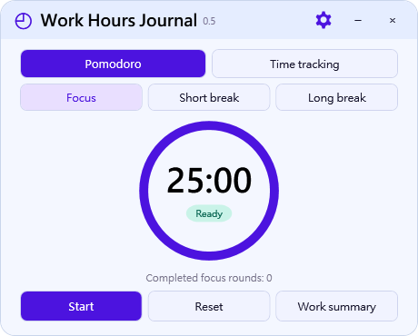
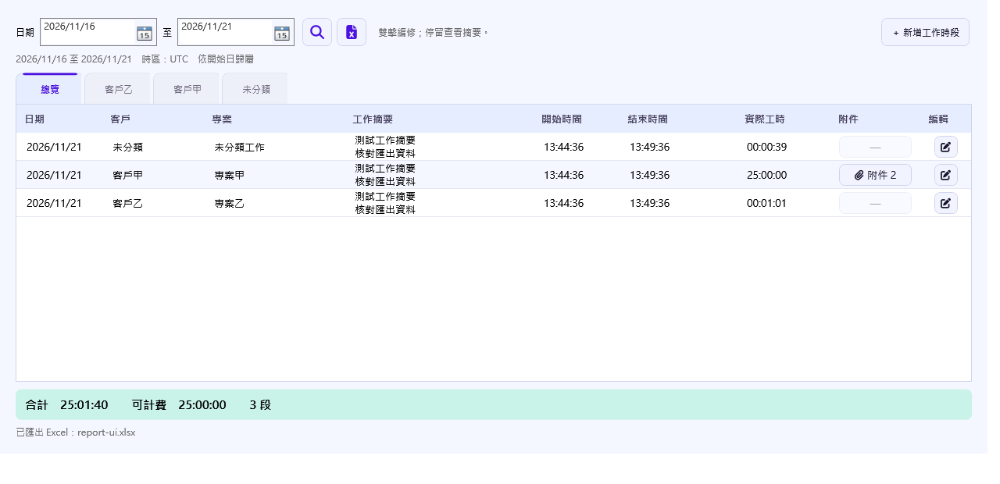
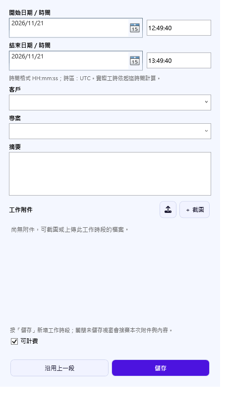
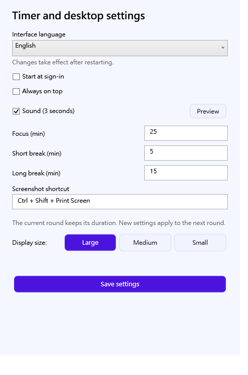

# Work Hours Journal

[繁體中文](README.md) | **English**

**Keep your focus sessions, work notes, and time reports together.**

Work Hours Journal (工時手札) is a Windows desktop app that combines a Pomodoro timer, elapsed-time tracking, customer and project organization, work summaries, and attachments. Use it to record what you worked on, review time spent on projects, and export billable hours to Excel.

**[Download v0.5.2 for Windows](https://github.com/JDYU0814/WorkHoursJournal-Downloads/releases/download/v0.5.2/WorkHoursJournal-multilingual.exe)** · [Latest release](https://github.com/JDYU0814/WorkHoursJournal-Downloads/releases/latest) · [Release notes](https://github.com/JDYU0814/WorkHoursJournal-Downloads/releases/tag/v0.5.2)

Windows x64 | Traditional Chinese · Simplified Chinese · English | Portable executable | Local data storage

<p align="center">
  
</p>

## Features

| Feature | What you can do |
| --- | --- |
| Pomodoro timer | Switch between focus, short break, and long break sessions. The defaults are 25, 5, and 15 minutes, with customizable durations. A long break is prepared after four completed focus rounds. Each stage starts manually. |
| Time tracking | Track elapsed work time with Start, Pause, Resume, and Reset. Pauses and breaks do not count toward work time. Totals can exceed 24 hours. |
| Work summaries | Record a customer, project, summary, and billable status for each session. Reuse the previous session's details or choose customer and project names from history. |
| Attachments | Attach screenshots or uploaded files to a work session. Preview images, rename attachments, save copies, or remove them. |
| Time reports | Query a date range, review all customers or a single customer, check totals, add sessions manually, and edit historical records. |
| Excel export | Export an overview and all customer details for the queried date range, including summaries, actual time, billable time, and attachment links. |
| Desktop display | Use the full window, a compact circular widget, or the system tray. Optional settings include always-on-top and starting at sign-in. |
| Three languages | Choose Traditional Chinese, Simplified Chinese, or English. Save and restart to apply the selection. Excel exports follow the selected startup language. |

## Download and get started

| Item | Details |
| --- | --- |
| Current release | **v0.5.2**, executable version `0.5.2.0` |
| Operating system | Windows x64; the target environment is Windows 11 |
| Download | [`WorkHoursJournal-multilingual.exe`](https://github.com/JDYU0814/WorkHoursJournal-Downloads/releases/download/v0.5.2/WorkHoursJournal-multilingual.exe) |
| File size | Approximately **177.45 MiB** (186,066,574 bytes) |
| Installation | Download and run the single executable. The .NET runtime is included; no separate .NET installation is required. |

1. Download the `.exe`, keep it in a convenient location, and open it.
2. The default interface is Traditional Chinese. To switch to English, open the gear icon, select `English` under `介面語言`, and click `儲存設定`. From the system tray, choose `結束程式` to exit, then reopen the app.
3. Select **Pomodoro** or **Time tracking**.
4. Open **Work summary**, enter the customer, project, and work notes, then click **Save**. You can also write or update the summary while the timer is running.
5. Click **Start** to begin. Use **Pause** when needed and **Resume** to continue.
6. A completed Pomodoro focus session saves its effective work time automatically. In Time tracking mode, use **Reset** and follow the prompts to save the session and prepare the next assignment.
7. Open **Time reports and Excel export** from the system tray to review or export saved sessions.

> **Closing the window minimizes the app to the system tray; it may continue timing.** To quit completely, choose **Exit** from the tray menu and follow any prompts about unfinished work.

## Screenshots

All screenshots use sample data. The `0.5` shown in the window header identifies the release series; the downloadable executable's full version is `0.5.2.0`.

### Date queries, customer tabs, and work summaries

Choose a start and end date, then click the search icon. The overview includes all customers, while individual customer tabs provide a focused view. Review summaries, durations, and attachments in the table. Double-click a record or use its edit button to update the session.

The report screenshot below uses the Traditional Chinese interface and sample customer names. The app also supports this interface in English.



### Add a work session manually

Forgot to start the timer? Click **Add session** in the report window and enter the start and end times, customer, project, summary, and billable status. You can also add screenshots or files.

The manual-entry screenshot below uses the Traditional Chinese interface.



### Language and desktop settings

Open the gear icon or **Settings** in the tray menu to adjust the interface language, timer durations, sound, screenshot shortcut, and display size.



## Common tasks

### Change the interface language

1. Open **Settings**.
2. Under **Interface language**, select `繁體中文`, `简体中文`, or `English`.
3. Click **Save settings**. The app will tell you that the change takes effect after restarting.
4. Choose **Exit** from the system tray, then reopen the executable.

The current session keeps its existing language. After restarting, the interface and Excel labels—including headers, default worksheet names, totals, and Yes/No values—use the selected language. Customer names, project names, summaries, and attachment names that you enter are preserved as written.

### Add screenshots and files

- In a work summary or session editor, click **＋ Screenshot** to select a screen region. Press Esc to cancel.
- The default screenshot shortcut is `Ctrl + Shift + Print Screen`. You can change it in Settings.
- Use the upload button to add files. Images can be previewed; other files can be saved as copies and opened with a suitable app.
- Attachments belong to their individual work sessions and can be accessed later from the report.

### Query sessions and export to Excel

1. Open **Time reports and Excel export** from the tray menu.
2. Select the start and end dates, then click the search icon.
3. Review the results, click the Excel icon, and choose a save location.

The export includes **the overview and all customer details in the executed query**, even when you are viewing a single customer tab. If you change the dates, run the query again before exporting.

When records include attachments, export creates an attachment folder next to the workbook. **Keep the workbook and its adjacent attachment folder together** when sharing or moving them so the relative links continue to work.

### Update the app

1. Choose **Exit** from the tray menu and save unfinished work when prompted.
2. Download the new executable from [Releases](https://github.com/JDYU0814/WorkHoursJournal-Downloads/releases).
3. Open the new version. Existing work records and settings stored on your computer are reused.

Clicking the window's **×** button does not fully exit the app. Use the tray menu before updating.

## Local data and backups

Work records are stored on your computer in:

```text
%LOCALAPPDATA%\WorkHoursJournal
```

This folder contains the time database, desktop settings, and work attachments. The app does not automatically upload work records or screenshots, and it does not automatically synchronize data between computers.

To back up your data, exit the app completely and copy the entire folder so records, settings, and attachments stay together. The executable is portable, but work data is stored in the folder above rather than alongside the executable.

## Frequently asked questions

**Which file should I download?**  
Download `WorkHoursJournal-multilingual.exe`. GitHub's **Source code (zip)** and **Source code (tar.gz)** links contain only this download repository's documentation, screenshots, and license notices. They are not runnable apps and do not include the product's application source code.

**Do I need .NET or Microsoft Excel installed?**  
No separate .NET installation is needed. Running the app and generating Excel reports do not require Microsoft Excel. To open an exported `.xlsx` file, use spreadsheet software that supports the format.

**Where did the app go after I closed its window?**  
It stays in the Windows system tray. Closing the window does not automatically stop timing. Use the tray menu to show the window again or exit completely.

**Why did the language not change immediately?**  
This is expected. Save the language selection, exit completely from the tray menu, and reopen the app to apply it.

**What happens after sleep or a restart?**  
Elapsed-time tracking waits for you to resume after sleep. Pomodoro sessions recover and settle using their saved deadline. Follow the status and prompts shown when the app resumes or restarts.

## Version verification

v0.5.2 passed **144 core/export checks** and **128 UI checks against the packaged executable**. Mixed-DPI displays, multiple monitors, physical sleep/wake cycles, and full system shutdown behavior still require validation on the actual devices used.

<details>
<summary>Verify the v0.5.2 executable's SHA-256</summary>

Executable version: `0.5.2.0`. Size: `186066574` bytes.

```text
B3A8A30AE78AB558F3E9F5D2334923FF39DAD7AED1B1FACF5ED92E5CCA5E3049
```

Run the following in PowerShell from the executable's folder:

```powershell
Get-FileHash .\WorkHoursJournal-multilingual.exe -Algorithm SHA256
```

</details>

## Share or report an issue

Share this English introduction:

**[Work Hours Journal — English README](https://github.com/JDYU0814/WorkHoursJournal-Downloads/blob/main/README.en.md)**

To report a problem, open an [Issue](https://github.com/JDYU0814/WorkHoursJournal-Downloads/issues) with the app version, Windows version, steps to reproduce, and any error message. Before posting screenshots, hide customer names, work notes, or other information you do not want to make public.

This repository provides executable downloads, product documentation, and screenshots. The application's source code is private. Third-party license notices are available in [THIRD-PARTY-LICENSES](THIRD-PARTY-LICENSES/).