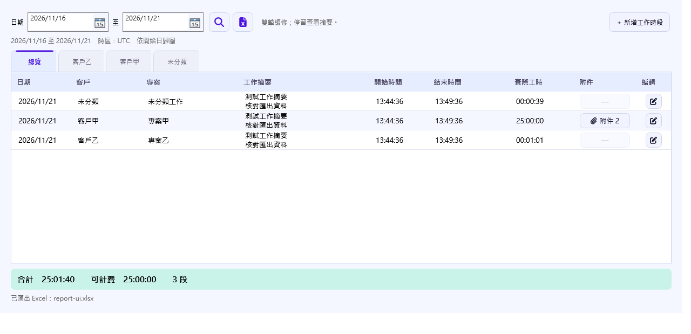
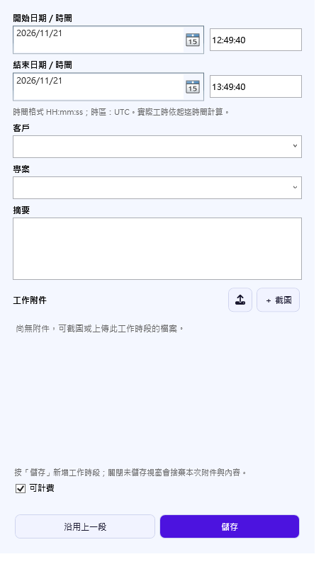
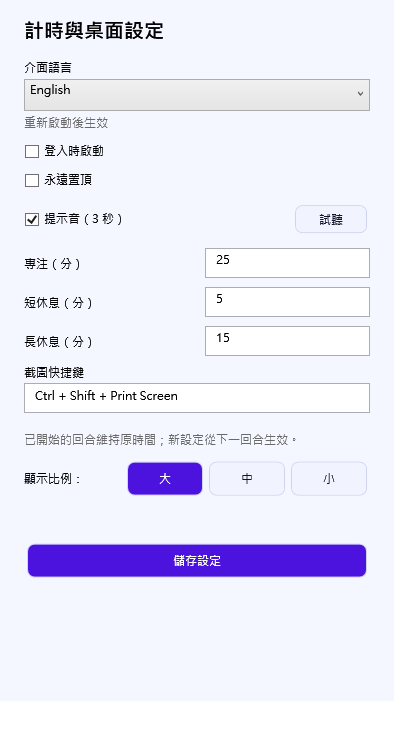
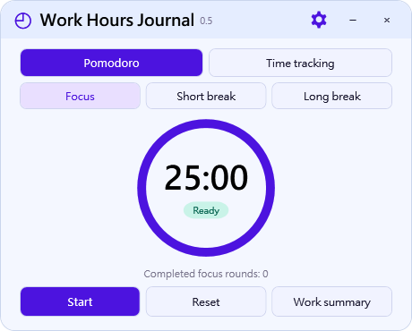

# 工時手札

**繁體中文** | [English](README.en.md)

**把專注時間、工作內容與工時報表，留在同一個桌面工具裡。**

工時手札是一款 Windows 桌面工具，結合番茄鐘、正向工時計時、客戶／專案分類、工作摘要與附件，並可將紀錄匯出成 Excel。適合需要記錄每天做了什麼、整理專案投入時間，或彙整可計費工時的人使用。

**[下載 v0.5.2 執行檔](https://github.com/JDYU0814/WorkHoursJournal-Downloads/releases/download/v0.5.2/WorkHoursJournal-multilingual.exe)** · [查看最新版本](https://github.com/JDYU0814/WorkHoursJournal-Downloads/releases/latest) · [版本說明](https://github.com/JDYU0814/WorkHoursJournal-Downloads/releases/tag/v0.5.2)

Windows x64｜繁體中文・简体中文・English｜可攜執行｜資料保存在本機

<p align="center">
  
</p>

## 可以做什麼？

| 功能 | 使用方式與特色 |
| --- | --- |
| 番茄鐘 | 專注、短休息、長休息三種階段；預設 25／5／15 分鐘，可自行調整。完成四次專注後準備長休息，各階段由你手動開始。 |
| 工時統計 | 正向累計有效工作時間，可暫停、繼續與重置；暫停及休息不列入工時，累計時間可超過 24 小時。 |
| 工作摘要 | 記錄客戶、專案、摘要及可計費標記，可沿用上一段工作，也能從歷史名稱挑選客戶與專案。 |
| 工作附件 | 截圖或上傳檔案並綁定工作時段；支援圖片預覽、修改顯示名稱、另存與移除附件。 |
| 工時報表 | 按日期查詢，以總覽或客戶分頁查看紀錄與合計；支援補登工作時段及編輯歷史紀錄。 |
| Excel 匯出 | 匯出本次查詢的總覽與所有客戶明細，包含工作摘要、實際工時、可計費工時與附件連結。 |
| 桌面顯示 | 可使用完整視窗、精簡圓環或縮小至系統匣，並設定永遠置頂與登入時啟動。 |
| 三種語言 | 設定可選繁體中文、簡體中文、English；儲存後下次啟動生效，Excel 匯出也跟隨語言。 |

## 下載與開始使用

| 項目 | 說明 |
| --- | --- |
| 目前版本 | **v0.5.2**，執行檔版本 `0.5.2.0` |
| 作業系統 | Windows x64；目標使用環境為 Windows 11 |
| 下載檔案 | [`WorkHoursJournal-multilingual.exe`](https://github.com/JDYU0814/WorkHoursJournal-Downloads/releases/download/v0.5.2/WorkHoursJournal-multilingual.exe) |
| 檔案大小 | 約 **177.45 MiB**（186,066,574 bytes） |
| 安裝方式 | 單一可攜執行檔，下載後直接開啟；已包含 .NET 執行階段，不需另外安裝 .NET |

1. 下載上方的 `.exe`，放到方便保留的位置後開啟。
2. 選擇「番茄鐘」或「工時統計」。
3. 按「工作摘要」，填寫客戶、專案及工作內容，再按「儲存」。摘要也能在計時中補寫。
4. 按「開始」計時，需要休息時按「暫停」，回來後按「繼續」。
5. 番茄鐘完成專注會自動保存有效工時；工時統計按「重置」後依提示保存本段並開始下一段指派。
6. 從右下角系統匣開啟「工時查詢與 Excel 匯出」，查看或匯出紀錄。

> **關閉視窗會縮小到系統匣，計時仍可能繼續。** 要完全退出，請在系統匣選單選擇「結束程式」，再依提示處理尚未完成的工作。

## 操作畫面

以下皆為測試資料畫面，客戶、專案與附件為示範內容。視窗標題的 `0.5` 為系列版本，下載執行檔的完整版本為 `0.5.2.0`。

### 日期查詢、客戶分類與工作摘要

選擇起迄日期後，按放大鏡查詢。總覽顯示全部客戶，也能切換到單一客戶分頁；表格可直接查看摘要、工時與附件。雙擊紀錄或按右側編輯按鈕，即可編修工作時段。



### 手動補登工作時段

忘記開計時器時，可在報表右上角按「新增工作時段」，補上開始與結束時間、客戶、專案、摘要及可計費標記，也能附上截圖或檔案。



### 語言與桌面設定

從主畫面的齒輪或系統匣「設定」開啟，調整介面語言、計時分鐘、提示音、截圖快捷鍵與顯示比例。



圖中選擇 `English` 後，當前畫面仍維持繁體中文；儲存並重新啟動後才會切換。英文主畫面如下：



## 常用操作

### 切換介面語言

1. 開啟「設定」。
2. 在「介面語言」選擇「繁體中文」、「简体中文」或 `English`。
3. 按「儲存設定」，程式會提示「重新啟動後生效」。
4. 從系統匣選「結束程式」，再重新開啟執行檔。

本次執行期間維持原語言；重啟後，介面及 Excel 欄位、預設工作表名稱、合計與是／否等文字會套用新語言。自行輸入的客戶、專案、摘要及附件名稱不會被翻譯。

### 加入截圖與附件

- 在「工作摘要」或工作時段編輯視窗，按「＋ 截圖」選取畫面區域；按 Esc 可取消。
- 預設截圖快捷鍵為 `Ctrl + Shift + Print Screen`，可在設定調整。
- 也能使用上傳按鈕加入檔案。圖片可預覽，其他檔案可另存後使用適合的程式開啟。
- 附件綁定個別工作時段，方便日後從報表查閱。

### 查詢及匯出 Excel

1. 從系統匣開啟「工時查詢與 Excel 匯出」。
2. 選擇起日與迄日，按放大鏡查詢。
3. 確認結果後按 Excel 圖示，選擇儲存位置。

匯出包含**本次查詢的總覽與所有客戶明細**，不因畫面停在單一客戶分頁而縮小匯出範圍。修改日期後，需重新查詢才能匯出。

若紀錄含附件，匯出時會在 Excel 旁建立附件資料夾；分享或搬移報表時，請將 **Excel 與同層附件資料夾一起保留**，相對連結才能繼續使用。

### 更新版本

1. 先從系統匣「結束程式」，依提示保存目前工作。
2. 從 [Releases](https://github.com/JDYU0814/WorkHoursJournal-Downloads/releases) 下載新版執行檔。
3. 開啟新版，原本保存在本機的工作紀錄與設定會沿用。

請注意：只按視窗右上角的「×」不會完全退出，更新前須從系統匣結束程式。

## 資料保存與備份

工作資料保存在本機：

```text
%LOCALAPPDATA%\WorkHoursJournal
```

此資料夾包含工時資料庫、桌面設定與工作附件。程式不會自動上傳工時資料或截圖，也不會自動同步到其他電腦。

如需備份，請先完全退出程式，再複製整個資料夾，讓工時、設定與附件一起保留。執行檔可攜帶，不代表工作資料會存放在執行檔旁邊。

## 常見問題

**下載頁面該選哪個檔案？**  
請下載 `WorkHoursJournal-multilingual.exe`。GitHub 顯示的「Source code (zip)」及「Source code (tar.gz)」只包含此下載 repo 的說明、截圖及授權文件，不是可執行程式，也不包含本產品的程式原始碼。

**需要安裝 .NET 或 Microsoft Excel 才能使用嗎？**  
不需要另裝 .NET。程式本身與產生 Excel 報表不依賴本機安裝 Microsoft Excel；要開啟匯出的 `.xlsx`，可使用支援該格式的試算表軟體。

**關閉主畫面後，程式去哪裡了？**  
程式會留在 Windows 系統匣，計時不會因為關閉視窗自動停止。可從系統匣選單重新顯示視窗或完全退出。

**切換語言後，為什麼畫面沒有立即變更？**  
這是預期行為。儲存語言後，請從系統匣完全退出再開啟，新語言才會生效。

**睡眠或重新開機後，會持續計算工時嗎？**  
正向工時在睡眠後等待手動繼續；番茄鐘依保存的截止時間恢復與結算。重新啟動後的實際狀態以畫面提示為準。

## 版本核對

目前 v0.5.2 已通過 **144 項核心／匯出檢查**與 **128 項打包後介面檢查**。混合 DPI、多螢幕、實機睡眠喚醒及整機關機等行為仍需依實際設備驗收。

<details>
<summary>檢查 v0.5.2 執行檔的 SHA-256</summary>

執行檔版本：`0.5.2.0`，大小：`186066574` bytes。

```text
B3A8A30AE78AB558F3E9F5D2334923FF39DAD7AED1B1FACF5ED92E5CCA5E3049
```

可在執行檔所在資料夾使用 PowerShell 核對：

```powershell
Get-FileHash .\WorkHoursJournal-multilingual.exe -Algorithm SHA256
```

</details>

## 分享與回報問題

分享給其他人時，可直接傳送本頁：

**https://github.com/JDYU0814/WorkHoursJournal-Downloads**

如需回報問題，請到 [Issues](https://github.com/JDYU0814/WorkHoursJournal-Downloads/issues) 提供程式版本、Windows 版本、操作步驟與錯誤訊息。貼圖前請遮蔽客戶名稱、工作內容或其他不便公開的資料。

本 repo 僅用於執行檔下載、產品說明與操作截圖；程式原始碼不公開。第三方元件授權資訊見 [THIRD-PARTY-LICENSES](THIRD-PARTY-LICENSES/)。