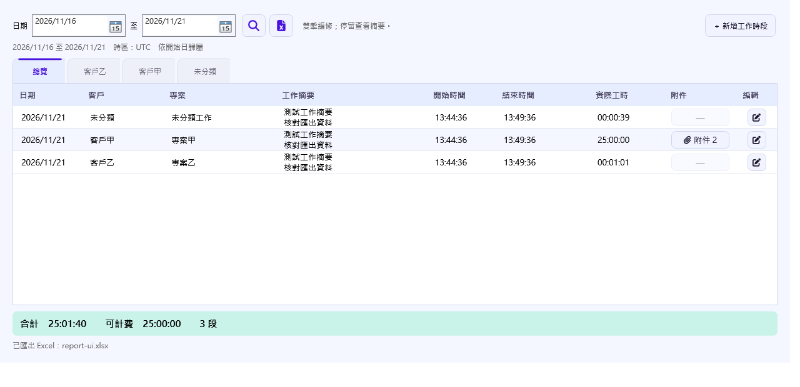
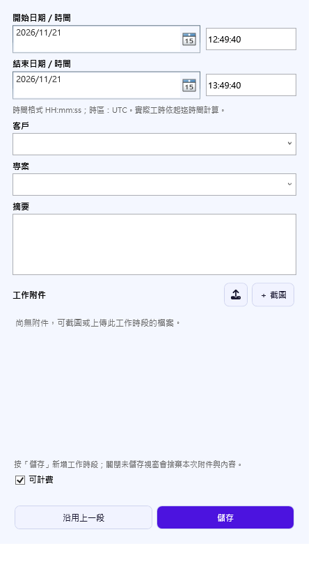
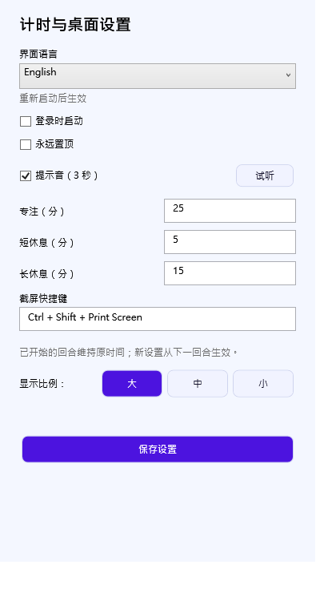
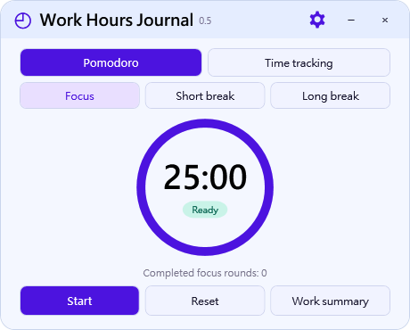

# 工时手札

[繁體中文](README.md) | **简体中文** | [English](README.en.md)

**把专注时间、工作内容与工时报表，留在同一个桌面工具里。**

工时手札是一款 Windows 桌面工具，结合番茄钟、正向工时计时、客户／项目分类、工作摘要与附件，并可将记录导出成 Excel。适合需要记录每天做了什么、整理项目投入时间，或汇总可计费工时的人使用。

**[下载 v0.5.2 可执行文件](https://github.com/JDYU0814/WorkHoursJournal-Downloads/releases/download/v0.5.2/WorkHoursJournal-multilingual.exe)** · [查看最新版本](https://github.com/JDYU0814/WorkHoursJournal-Downloads/releases/latest) · [版本说明](https://github.com/JDYU0814/WorkHoursJournal-Downloads/releases/tag/v0.5.2)

Windows x64｜繁体中文・简体中文・English｜便携运行｜数据保存在本机

<p align="center">
  
</p>

## 可以做什么？

| 功能 | 使用方式与特色 |
| --- | --- |
| 番茄钟 | 专注、短休息、长休息三种阶段；默认 25／5／15 分钟，可自行调整。完成四次专注后准备长休息，各阶段由你手动开始。 |
| 工时统计 | 正向累计有效工作时间，可暂停、继续与重置；暂停及休息不列入工时，累计时间可超过 24 小时。 |
| 工作摘要 | 记录客户、项目、摘要及可计费标记，可沿用上一段工作，也能从历史名称挑选客户与项目。 |
| 工作附件 | 截屏或上传文件并绑定工作时段；支持图片预览、修改显示名称、另存与移除附件。 |
| 工时报表 | 按日期查找，以总览或客户分页查看记录与合计；支持补登工作时段及编辑历史记录。 |
| Excel 导出 | 导出本次查找的总览与所有客户明细，包含工作摘要、实际工时、可计费工时与附件链接。 |
| 桌面显示 | 可使用完整窗口、精简圆环或缩小至系统托盘，并设置永远置顶与登录时启动。 |
| 三种语言 | 设置可选繁体中文、简体中文、English；保存后下次启动生效，Excel 导出也跟随语言。 |

## 下载与开始使用

| 项目 | 说明 |
| --- | --- |
| 目前版本 | **v0.5.2**，可执行文件版本 `0.5.2.0` |
| 操作系统 | Windows x64；目标使用环境为 Windows 11 |
| 下载文件 | [`WorkHoursJournal-multilingual.exe`](https://github.com/JDYU0814/WorkHoursJournal-Downloads/releases/download/v0.5.2/WorkHoursJournal-multilingual.exe) |
| 文件大小 | 约 **177.45 MiB**（186,066,574 bytes） |
| 安装方式 | 单一便携可执行文件，下载后直接打开；已包含 .NET 运行时，不需另外安装 .NET |

1. 下载上方的 `.exe`，放到方便保留的位置后打开。
2. 选择「番茄钟」或「工时统计」。
3. 按「工作摘要」，填写客户、项目及工作内容，再按「保存」。摘要也能在计时中补写。
4. 按「开始」计时，需要休息时按「暂停」，回来后按「继续」。
5. 番茄钟完成专注会自动保存有效工时；工时统计按「重置」后依提示保存本段并开始下一段指派。
6. 从右下角系统托盘打开「工时查找与 Excel 导出」，查看或导出记录。

> **关闭窗口会缩小到系统托盘，计时仍可能继续。** 要完全退出，请在系统托盘菜单选择「结束程序」，再依提示处理尚未完成的工作。

## 操作画面

以下均为测试数据截图，客户、项目与附件仅用于演示。报表和手动补登截图使用繁体中文界面；主画面与设置截图使用简体中文界面。窗口标题的 `0.5` 为系列版本，下载可执行文件的完整版本为 `0.5.2.0`。

### 日期查找、客户分类与工作摘要

选择起止日期后，按放大镜查找。总览显示全部客户，也能切换到单一客户分页；表格可直接查看摘要、工时与附件。双击记录或按右侧编辑按钮，即可编修工作时段。



### 手动补登工作时段

忘记开计时器时，可在报表右上角按「添加工作时段」，补上开始与结束时间、客户、项目、摘要及可计费标记，也能附上截屏或文件。



### 语言与桌面设置

从主画面的齿轮或系统托盘「设置」打开，调整界面语言、计时分钟、提示音、截屏快捷键与显示比例。



图中选择 `English` 后，当前界面仍保持简体中文；保存并重新启动后才会切换。英文主画面如下：



## 常用操作

### 切换界面语言

1. 打开「设置」。
2. 在「界面语言」选择「繁体中文」、「简体中文」或 `English`。
3. 按「保存设置」，程序会提示「重新启动后生效」。
4. 从系统托盘选「结束程序」，再重新打开可执行文件。

本次运行期间维持原语言；重启后，界面及 Excel 字段、默认工作表名称、合计与是／否等文本会套用新语言。自行输入的客户、项目、摘要及附件名称不会被翻译。

### 加入截屏与附件

- 在「工作摘要」或工作时段编辑窗口，按「＋ 截屏」选取画面区域；按 Esc 可取消。
- 默认截屏快捷键为 `Ctrl + Shift + Print Screen`，可在设置调整。
- 也能使用上传按钮加入文件。图片可预览，其他文件可另存后使用适合的程序打开。
- 附件绑定个别工作时段，方便日后从报表查阅。

### 查找及导出 Excel

1. 从系统托盘打开「工时查找与 Excel 导出」。
2. 选择开始日期与结束日期，按放大镜查找。
3. 确认结果后按 Excel 图标，选择保存位置。

导出包含**本次查找的总览与所有客户明细**，不因画面停在单一客户分页而缩小导出范围。修改日期后，需重新查找才能导出。

若记录含附件，导出时会在 Excel 旁创建附件文件夹；分享或搬移报表时，请将 **Excel 与同层附件文件夹一起保留**，相对链接才能继续使用。

### 更新版本

1. 先从系统托盘「结束程序」，依提示保存目前工作。
2. 从 [Releases](https://github.com/JDYU0814/WorkHoursJournal-Downloads/releases) 下载新版可执行文件。
3. 打开新版，原本保存在本机的工作记录与设置会沿用。

请注意：只按窗口右上角的「×」不会完全退出，更新前须从系统托盘结束程序。

## 数据保存与备份

工作数据保存在本机：

```text
%LOCALAPPDATA%\WorkHoursJournal
```

此文件夹包含工时数据库、桌面设置与工作附件。程序不会自动上传工时数据或截屏，也不会自动同步到其他电脑。

如需备份，请先完全退出程序，再复制整个文件夹，让工时、设置与附件一起保留。可执行文件可以便携运行，不代表工作数据会存放在可执行文件旁边。

## 常见问题

**下载页面该选哪个文件？**  
请下载 `WorkHoursJournal-multilingual.exe`。GitHub 显示的「Source code (zip)」及「Source code (tar.gz)」只包含此下载 repo 的说明、截屏及授权文档，不是可运行程序，也不包含本产品的程序源代码。

**需要安装 .NET 或 Microsoft Excel 才能使用吗？**  
不需要另装 .NET。程序本身与产生 Excel 报表不依赖本机安装 Microsoft Excel；要打开导出的 `.xlsx`，可使用支持该格式的电子表格软件。

**关闭主画面后，程序去哪里了？**  
程序会留在 Windows 系统托盘，计时不会因为关闭窗口自动停止。可从系统托盘菜单重新显示窗口或完全退出。

**切换语言后，为什么画面没有立即变更？**  
这是预期行为。保存语言后，请从系统托盘完全退出再打开，新语言才会生效。

**睡眠或重新开机后，会持续计算工时吗？**  
正向工时在睡眠后等待手动继续；番茄钟依保存的截止时间恢复与结算。重新启动后的实际状态以画面提示为准。

## 版本核对

目前 v0.5.2 已通过 **144 项核心／导出检查**与 **128 项打包后界面检查**。混合 DPI、多屏幕、实机睡眠唤醒及整机关机等行为仍需依实际设备验收。

<details>
<summary>检查 v0.5.2 可执行文件的 SHA-256</summary>

可执行文件版本：`0.5.2.0`，大小：`186066574` bytes。

```text
B3A8A30AE78AB558F3E9F5D2334923FF39DAD7AED1B1FACF5ED92E5CCA5E3049
```

可在可执行文件所在文件夹使用 PowerShell 核对：

```powershell
Get-FileHash .\WorkHoursJournal-multilingual.exe -Algorithm SHA256
```

</details>

## 分享与回报问题

分享给其他人时，可直接发送本页：

**[工时手札 — 简体中文说明](https://github.com/JDYU0814/WorkHoursJournal-Downloads/blob/main/README.zh-CN.md)**

如需回报问题，请到 [Issues](https://github.com/JDYU0814/WorkHoursJournal-Downloads/issues) 提供程序版本、Windows 版本、操作步骤与错误消息。贴图前请屏蔽客户名称、工作内容或其他不便公开的数据。

本 repo 仅用于可执行文件下载、产品说明与操作截屏；程序源代码不公开。第三方组件授权信息见 [THIRD-PARTY-LICENSES](THIRD-PARTY-LICENSES/)。